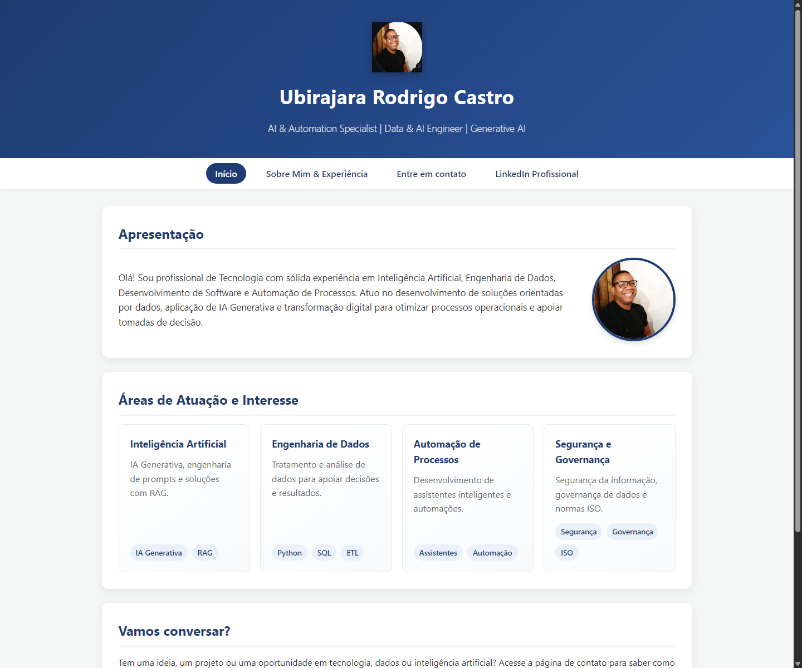

# Página Pessoal

Site pessoal desenvolvido por Ubirajara Rodrigo Castro para apresentar sua trajetória, áreas de interesse e informações de contato.

## Visualização

[Acesse o site publicado no GitHub Pages](https://ubirajaracastro87.github.io/ProgramacaoWEB/).

## Páginas

- `index.html`: apresentação, interesses e link para a página de contato.
- `sobre.html`: experiência profissional e formação acadêmica.
- `contato.html`: página complementar do projeto.

## Tecnologias

- HTML5
- CSS3

O layout usa CSS Grid na estrutura das páginas e Flexbox nos cartões de competências, na navegação e na apresentação do perfil. As seções se reorganizam para telas menores.

O formulário demonstra a estrutura HTML e a validação nativa dos campos. Ele não envia mensagens para um servidor.
